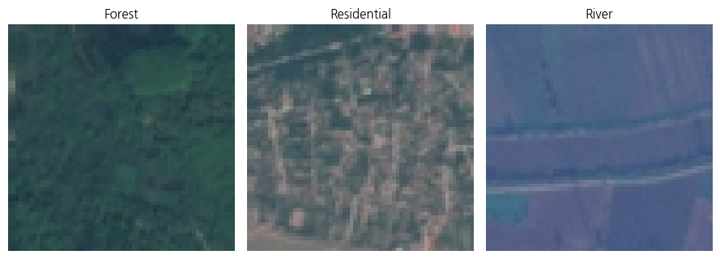
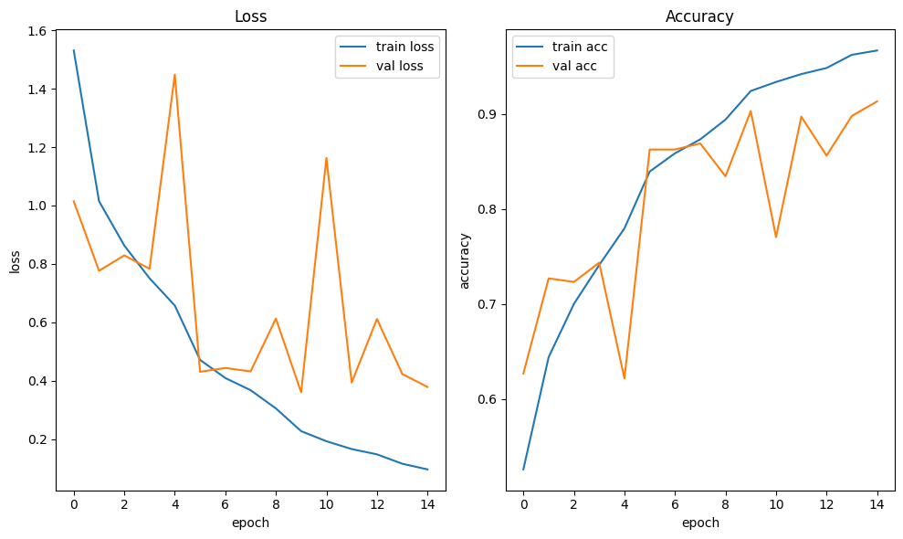
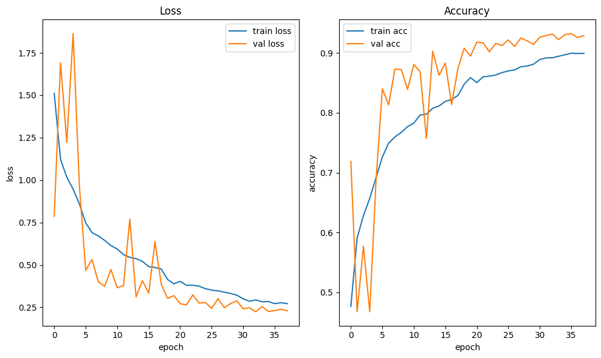
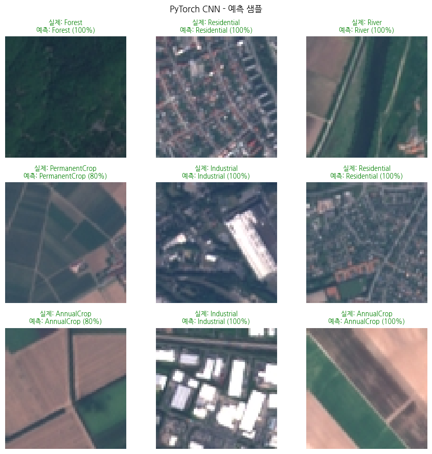

# EuroSAT-Classification

EuroSAT 위성 이미지(27,000장, 10개 토지 이용 클래스)로 **ANN · DNN · CNN**을 **Keras**와 **PyTorch**로 각각 구현(총 6개 모델)하고, 정확도·파라미터 수·학습 시간을 비교한 실험입니다.

> 같은 데이터셋에서 파라미터를 늘린 DNN보다 구조를 바꾼 CNN이 얼마나 더 효율적인지 확인하는 것이 목표입니다.

## 데이터

| 항목 | 내용 |
|---|---|
| 데이터셋 | EuroSAT (torchvision으로 자동 다운로드) |
| 규모 | 27,000장, 64×64 RGB, 10개 클래스 |
| 분할 | train / val / test = 70 / 15 / 15 |
| 환경 | Google Colab T4 GPU |

## 실험 조건

- 구조 3가지(ANN, DNN, CNN) × 프레임워크 2가지(Keras, PyTorch) = 6개 모델
- Adam, 배치 크기 32, EarlyStopping, ReduceLROnPlateau
- 가중치 초기화를 He/Kaiming으로 통일한 뒤 재실험

## 결과

| 모델 | 프레임워크 | Test Accuracy | Test Loss | 파라미터 수 | 학습 시간(초)* |
|---|---|---|---|---|---|
| ANN | Keras | 27.38% | 1.7916 | 3,148,554 | 65.4 |
| ANN | PyTorch | 21.63% | 1.9173 | 3,148,554 | 130.3 |
| DNN | Keras | 39.09% | 1.6003 | 6,457,482 | 72.0 |
| DNN | PyTorch | 29.06% | 1.7606 | 6,457,482 | 144.3 |
| CNN | Keras | 90.94% | 0.3117 | 2,194,122 | 87.9 |
| **CNN** | **PyTorch** | **93.70%** | **0.2094** | 2,193,674 | 582.4 |

\* Colab T4 GPU에서 1회 실행한 참고값입니다. 같은 구조의 Keras·PyTorch 수치 차이는 난수·구현 차이를 포함하므로 프레임워크 우열을 비교하려는 것이 아닙니다.

- **CNN**이 두 프레임워크 모두에서 **가장 적은 파라미터(약 219만 개)로 가장 높은 정확도**를 기록했습니다.
- DNN은 ANN보다 파라미터가 2배 이상 많지만 정확도는 약 7~12%p 오르는 데 그쳤습니다.

### CNN 학습 곡선

| Keras | PyTorch |
|---|---|
|  |  |

### 예측 샘플 (PyTorch CNN)

## 한계

- 단일 실행 결과입니다. 재학습마다 수치가 달라졌습니다(예: Keras CNN 93.8% → 90.9%).
- GPU(T4) 환경에서만 실험해 CPU 학습 시간은 비교하지 않았습니다.
- 전이학습(ResNet, MobileNet)과 Grad-CAM 같은 해석 시각화는 다루지 않았습니다.
- Keras는 비학습 파라미터(BatchNorm 이동 평균·분산)까지 총계에 포함해, 같은 구조여도 파라미터 수가 PyTorch와 약간 다르게 표시됩니다.

## 노트북

| 파일 | 내용 |
|---|---|
| `notebooks/01_data_prepare_eurosat.ipynb` | 데이터 다운로드, 분할 |
| `notebooks/02_keras_ann.ipynb` | Keras ANN |
| `notebooks/03_keras_dnn.ipynb` | Keras DNN |
| `notebooks/04_keras_cnn.ipynb` | Keras CNN |
| `notebooks/05_pytorch_ann.ipynb` | PyTorch ANN |
| `notebooks/06_pytorch_dnn.ipynb` | PyTorch DNN |
| `notebooks/07_pytorch_cnn.ipynb` | PyTorch CNN |
| `notebooks/08_inference_analysis_fixed.ipynb` | 추론·오류 분석, 예측 샘플 |

Google Colab에서 01번부터 순서대로 실행합니다(분할 데이터는 Google Drive에 저장해 재사용).

`Python` `Keras/TensorFlow` `PyTorch` `Google Colab`
